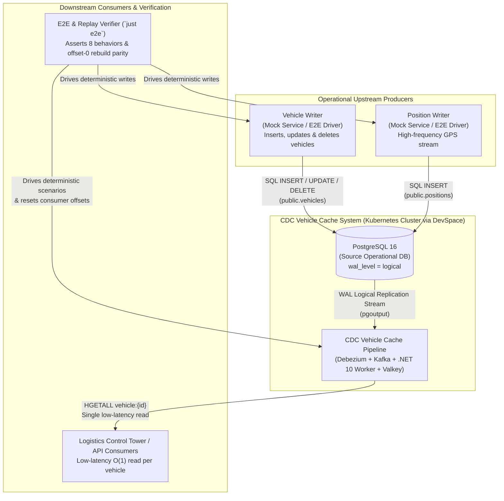
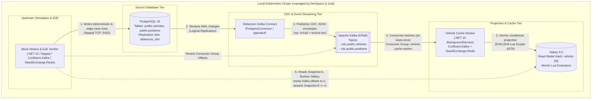
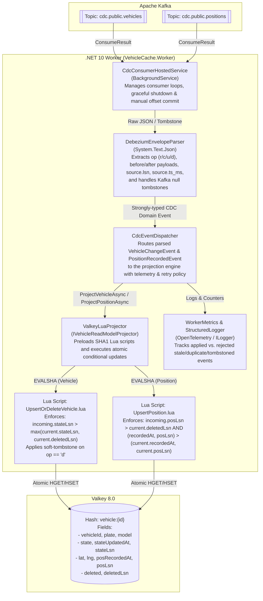

# Document 1 — C4 Architecture Model (`case-cdc-vehicle-cache`)

> **System:** CDC-Driven Vehicle Read-Model Cache (`.NET 10 Worker`)  
> **Team:** NsTech Data Platform — Technical Challenge  
> **Scope:** Context (Level 1), Container (Level 2), and Component (Level 3) views matching the exact topology deployed by `just up` and verified by `just e2e`.

---

## 1. System Context View (C4 — Level 1)

At the highest level, upstream operational producers (`Mock Vehicle Writer` and `Mock Position Writer`) mutate the operational **PostgreSQL** database. Without ever querying PostgreSQL directly, the **CDC Vehicle Cache System** captures row-level Write-Ahead Log (WAL) changes via **Debezium + Kafka**, projects them through a **.NET 10 Worker**, and maintains a low-latency, self-healing **Valkey** read model that answers in a single atomic read (`HGETALL vehicle:{id}`):

> *"Where is vehicle `{id}` right now, and what operational state is it in?"*

---

## 2. Container View (C4 — Level 2)

The Container diagram reflects the exact runtime containers orchestrated inside the local Kubernetes cluster by `devspace` (`just up`) and exercised by `just e2e`:

| Container | Technology | Responsibility |
|---|---|---|
| `postgres` | PostgreSQL 16 (`wal_level=logical`) | Operational source of truth hosting `public.vehicles` (mutable lifecycle + deletes) and `public.positions` (insert-only GPS telemetry). Never queried by the Worker. |
| `kafka` | Apache Kafka (KRaft mode) | Durable, partitioned event log storing Debezium CDC topics (`cdc.public.vehicles` and `cdc.public.positions`) from offset `0`. |
| `debezium-connect` | Debezium 2.7 / Kafka Connect | Tails PostgreSQL WAL via `pgoutput` replication slot and emits structured change envelopes (`op: r, c, u, d` + `source.lsn` + `source.ts_ms`). |
| `vehicle-cache-worker` | .NET 10 `BackgroundService` (`C# 13`) | Consumes both CDC topics with manual offset control and executes atomic Lua projection scripts against Valkey. |
| `valkey` | Valkey 8.0 (OSS Redis-compatible) | Low-latency in-memory store holding one Hash per vehicle (`vehicle:{id}`) with monotonic LSN/timestamp guards and soft-tombstone protection. |
| `mock-writers` / `e2e-runner` | .NET 10 CLI / xUnit Test Harness | Deterministically seeds PostgreSQL (normal lifecycle, out-of-order events, duplicates, cross-stream races, deletes) and verifies full replay parity. |

---

## 3. Component View — `.NET 10 Worker` (C4 — Level 3)

Inside the `vehicle-cache-worker` container, responsibilities are cleanly separated following **Single Responsibility** and **Dependency Inversion** so that CDC envelope parsing, domain ordering rules, and Valkey Lua execution can be unit-tested independently and verified end-to-end:

### Key Architectural Guarantees Shown in the Component View
1. **Strict Zero-Postgres Dependency in Worker:** `VehicleCache.Worker` has zero reference to `Npgsql` or PostgreSQL connection strings. Its sole inputs are the Kafka CDC topics.
2. **Manual Offset Commit After Projection:** Offsets are committed to Kafka (`StoreOffset` / `Commit`) **only after** `ValkeyLuaProjector` confirms the atomic Lua script executed in Valkey, guaranteeing at-least-once delivery without silent data loss.
3. **Single-Key Read Model (`vehicle:{id}`):** Both `UpsertOrDeleteVehicle.lua` and `UpsertPosition.lua` project into the same Valkey Hash key `vehicle:{id}`, allowing downstream consumers to fetch the complete vehicle state + latest GPS coordinates in one `HGETALL vehicle:{id}` network round-trip.
